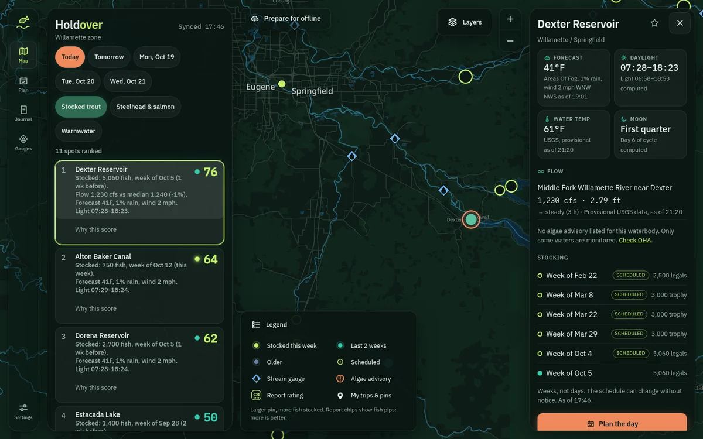
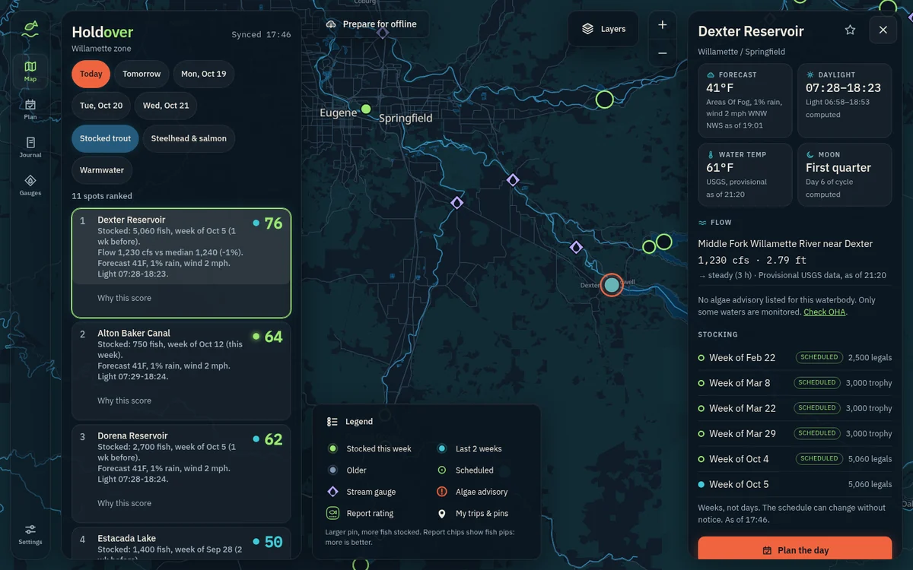
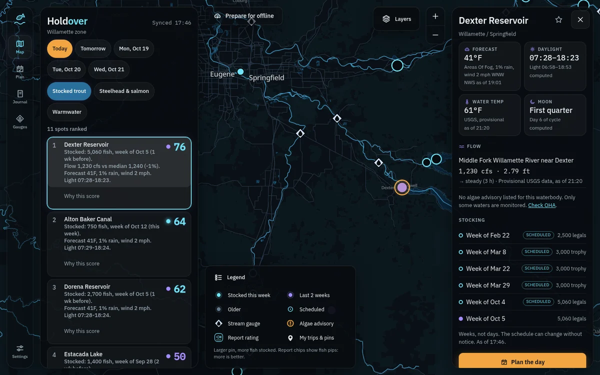
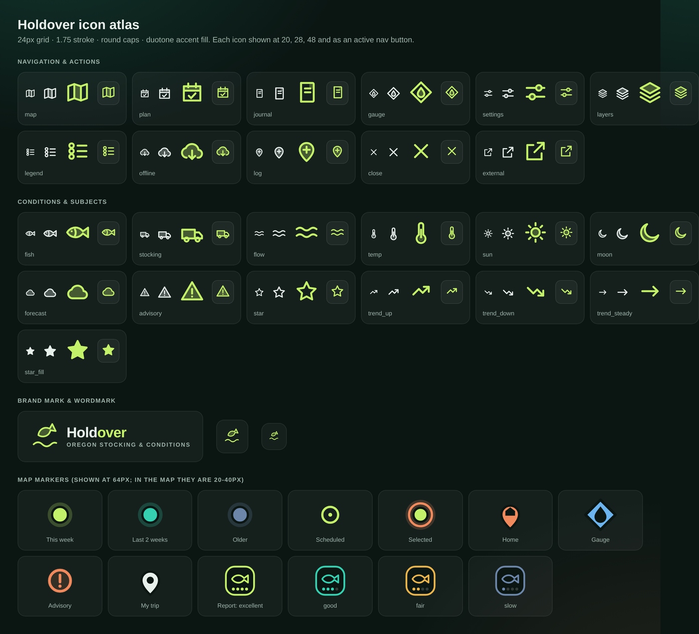

# Holdover brand guide

How Holdover looks, sounds and behaves. **This file is the authority for visuals and voice**; where the original
handoff's design section disagrees, this wins (see ROADMAP, "Where the build departs from the original handoff").
Agent rules for using it are in [AGENTS.md](../AGENTS.md).

**Source of truth in code** (change the guide and the code together; `tests/test_docs.py` checks the tokens below
against the CSS):

| What | File |
| --- | --- |
| Colour tokens, glass, hairlines, form controls, map-control styling | `web/src/theme.css` |
| Icons, brand mark, map-marker art | `web/src/lib/icons.js` (rendered by `Icon.svelte`, `Logo.svelte`, `MapView.svelte`, `Legend.svelte`) |
| Basemap styling | `web/src/lib/MapView.svelte` |
| App icon / favicon | `web/public/icon.svg`, `icon-192.png`, `icon-512.png`, `icon-maskable-512.png` |
| Map label glyphs | `web/public/fonts/` (Noto Sans, OFL) |

## 1. Essence

**Holdover** is ODFW's word for a stocked fish that survives to the next season: the one that stayed. The product is a
calm, knowledgeable guide to Oregon fishing: where, when, and what to bring, plus a private logbook.

Personality: **calm, precise, outdoors-literate.** A good guide, not a gadget. It knows the water, shows its
working, and is honest about what it does not know.

Look: a deep fir-green night, glass panels floating over a living map, one warm accent. Premium without shouting.



## 2. Voice

- **Plain and specific.** "Stocked the week of Oct 12", "Flow 1,240 cfs vs median 1,240". No hype, no exclamation
  marks, no fishing puns in the product.
- **Stocking is a week, not a day.** Always "week of". Add "schedule may change" where a date could be misread.
- **Never speak for the regulator.** The app links to official ODFW regulations. It never states a rule, limit, season
  or closure as fact. USGS values are "provisional".
- **Show the source.** Generated text says it is generated, by which model and when, and the original wording is one
  tap away. Facts come from data; the model only phrases them.
- **Say what is missing.** "No data" and "Little data behind this score" beat a confident guess.
- **Errors are specific and kind.** "Couldn't load gauges (503)." not "Something went wrong." Offline messages say
  what still works: "Saved on this phone, syncs when you have signal."
- **Empty states invite.** A short reason, then the one next action ("Log your first trip").
- **Flow context:** call the short baseline a recent seven-day median, never seasonal normal or a validated fishing range.
  Evidence percentages describe the share of scoring inputs backed by data, not the chance of catching a fish.

| Say | Not |
| --- | --- |
| Stocked: 5,060 fish, week of Oct 5 | Stocked on Oct 5! |
| Check ODFW for regulations | You can keep 5 trout here |
| Scores are starting points, not validated | Our AI picks the best spot |
| Little data behind this score | This is a great spot |

## 3. Logo and mark

- **Mark:** a steelhead leaping over a line of water (`mark` in `icons.js`). Filled body at 30% opacity with a 1.75
  stroke, so it holds together small. Colour: `--fresh-1`.
- **Wordmark:** "Hold" in `--text` and "over" in `--fresh-1`, IBM Plex Sans 600, letter-spacing -0.02em. Optional
  tagline "OREGON STOCKING & CONDITIONS" in small caps, tracking 0.14em, `--text-quiet`.
- **App icon:** the mark in lime on a deep fir-gradient tile. The maskable variant is full-bleed with the mark inside
  the safe zone.
- **Clear space:** at least the mark's own width on the left and right of the lockup. **Minimum:** mark 20 px; below
  that use the mark alone, never the lockup.
- **Don't:** recolour outside the theme's `--fresh-1`, stretch, add effects, put the wordmark on a light fill, or
  use the older three-wave glyph.

## 4. Colour

Three themes, switchable in Settings. **A theme is only a palette**: every component reads tokens and contains no
literal colours. Fir & Steelhead is the default.

### Tokens (exact copies of `theme.css`)

```css
/* tokens:fir */
--bg: #0b1613; --surface: #16261f; --line: #2a4036;
--primary: #2f6b52; --accent: #f08a5d;
--text: #e8f0ec; --text-quiet: #9db3a9;
--fresh-1: #c4f16a; --fresh-2: #35d0b0; --fresh-3: #6b86a8;
--land: #0e1c17; --forest: #112a1f; --water: #0e2b3b; --river: #2f84a6; --shore: #2a6f8f; --road: #2f463c; --road-minor: #22352d;
--gauge: #6cb4ee; --glow-1: rgba(53, 208, 176, 0.16); --glow-2: rgba(240, 138, 93, 0.10);
```

```css
/* tokens:redband */
--bg: #0c1620; --surface: #172636; --line: #2a4054;
--primary: #245a7d; --accent: #f0643f;
--text: #f3ebdf; --text-quiet: #a3b4c2;
--fresh-1: #9be86f; --fresh-2: #3fc9d6; --fresh-3: #7f95b4;
--land: #0f1c28; --forest: #123039; --water: #0a3350; --river: #3a9fd4; --shore: #2d7fb0; --road: #2f4659; --road-minor: #223648;
--gauge: #b9a7ff; --warn: #f5c04e; --glow-1: rgba(63, 201, 214, 0.14); --glow-2: rgba(240, 100, 63, 0.12);
```

```css
/* tokens:nightbite */
--bg: #080c10; --surface: #121a21; --line: #22313c;
--primary: #2a6f9c; --accent: #f2a541;
--text: #e6edf2; --text-quiet: #9aabb7;
--fresh-1: #6fe3f7; --fresh-2: #a58bff; --fresh-3: #62798f;
--land: #0a1016; --forest: #0d1b22; --water: #0b2438; --river: #4db2e6; --shore: #2f86b3; --road: #28394a; --road-minor: #1c2a37;
--gauge: #d3e4fb; --warn: #f2a541; --glow-1: rgba(165, 139, 255, 0.15); --glow-2: rgba(111, 227, 247, 0.10);
```

Shared defaults (all themes, in `:root`): `--warn: #e9b44c`, `--glass-line: rgba(255,255,255,0.09)`,
`--glass-fill: rgba(255,255,255,0.045)`, `--hair: rgba(255,255,255,0.07)`.

| Redband | Night Bite |
| --- | --- |
|  |  |

### Roles: one hue, one meaning

| Token | Role | Used for |
| --- | --- | --- |
| `--bg`, `--surface`, `--line` | Ground and structure | Page, panels (via glass), borders |
| `--text`, `--text-quiet` | Type | Body, secondary |
| `--accent` | **Action and warning** | Primary buttons, the selected day, the selected pin's ring, advisories, home pin. Never "good" or "bad" |
| `--primary` | Selection | Selected chips (text on it is `--on-primary`) |
| `--fresh-1` / `--fresh-2` / `--fresh-3` | Stocking freshness | This week / last 2 weeks / older. Also a score's strength, scheduled-tag outline, brand lime |
| `--gauge` | Stream gauges | The diamond marker and its icon, always |
| `--warn` | "Fair" and favorite star | Report chip "fair", the favorite star |
| `--land`, `--forest`, `--water`, `--river`, `--shore`, `--road`, `--road-minor` | Basemap | Never used for UI chrome |
| `--glow-1`, `--glow-2` | Atmosphere | The soft gradient behind non-map pages. No glows on UI elements (selection is a crisp outline) |

Rules:
- **Do not use red and green to mean good and bad.** Freshness uses separated hues plus size and shape, so it reads
  for colour-blind users and in sun. Report ratings also carry fish pips (1 to 4), never colour alone.
- Text on accent fills uses `--on-accent`. Text on primary uses `--on-primary`.
- A new colour needs a role in this table. If it has none, it does not belong.

### Contrast (computed from the tokens; keep at least these)

| Pair | Fir | Redband | Night Bite |
| --- | --- | --- | --- |
| `--text` on `--bg` | 15.9 | 15.4 | 16.6 |
| `--text-quiet` on `--bg` | 8.3 | 8.6 | 8.3 |
| `--fresh-1` on `--land` | 13.5 | 11.6 | 12.7 |
| `--fresh-2` on `--land` | 9.0 | 8.7 | 7.0 |
| `--fresh-3` on `--land` | 4.7 | 5.6 | 4.2 |
| `--gauge` on `--land` | 7.9 | 8.2 | 14.8 |
| `--accent` on `--bg` | 7.5 | 5.7 | 9.6 |
| `--on-primary` on `--primary` | 5.4 | 6.3 | 5.5 |

Text needs 4.5:1, graphics and map marks 3:1. Recompute for any palette change.

## 5. Typography

- **IBM Plex Sans** for the interface (400, 500, 600) and **IBM Plex Mono** for numbers (400, 500): flows, counts,
  coordinates, times, scores. Mono is for numerals only, never for words ("First quarter" is Sans). Tabular figures.
- Both are **self-hosted** (`@fontsource`, precached by the service worker). Never load fonts from a CDN: it breaks
  offline.
- Scale: page titles 22-24 px / -0.01em; body 14-15 px; secondary 13 px; **eyebrow labels** 10.5-11 px, 600, uppercase,
  tracking 0.09em, `--text-quiet`; the score is the hero number (24 px, 600).
- Map labels use bundled Noto Sans (Medium for places, Italic for water) so the map works offline.

## 6. Surfaces, space and layout

**Glass has two tiers.** Both sit over the full-bleed map with a hairline edge, an inner top highlight and a soft shadow.

| Tier | Use | Fill | Blur |
| --- | --- | --- | --- |
| Light | Nav rail, offline button, map controls, the closed Layers and Legend buttons | `--bg` at 58% | 20 px |
| Dense | Anything with text you must read: planner, side panel, detail sheet, the open Layers and Legend lists, popups | `--bg` at 94% | 28 px |

- **Rule:** if text sits on it, it is dense. (A light panel let pins show through a title; that is why.)
- **Gutter: 16 px** between panels and from every screen edge. The map is full-bleed; every control is measured from
  the screen edge, not from an inner container.
- **Radii:** controls 10, cards 14, panels 20 (top corners 20 on phone sheets). Cards are a faint white fill with a 1 px
  hairline, not a solid colour.
- **Side panel width follows content:** map 380, plan 520, journal 460, gauges 660 (two columns), settings 520, each
  capped to a share of the screen; the map re-centres in what remains. Below 900 px panels become a bottom sheet
  (68% tall for pages, 62% for the detail sheet) above a 64 px nav bar plus the safe area.
- **Breakpoints:** 900 px (phone layout below), 1100 px (zoom buttons and the offline label are hidden below it).
- **Phone sheets are opaque** (`--bg`, no blur): nothing may ghost through.
- Page headers use `PageHeader.svelte`: a 48 px `PageIcon`, a 14 px gap, and a title centred on the badge. Descriptions sit below that row so wrapping text cannot shift the icon. Reports, Plan, Journal, Gear, Gauges and Settings share this layout and 16 px content gutters.
- The Map's dense **Explore waters** card uses the same map badge/title alignment with a compact 20 px title and 16 px internal gutters. Best bets, Rivers and Favorites use the same underline selectors as Plan; fisheries remain filter chips. It includes statewide search. On a phone,
  its collapsed bar keeps a direct Rivers action visible; the expanded card is opaque and can use up to 68% of the available map height. Unpinned search results say "No map pin yet" and still open details.
- River detail sheets lead with a stored-observation chart, 24-hour/seven-day controls and a textual values alternative.
  Each measurement keeps its own as-of/stale state. Search fields use the same token-based treatment as other text fields.
- The full-height phone Plan panel reserves a 52 px control row above its content for the 44 px collapse button;
  the button must never cover the page title. The map and its controls share a labelled landmark.
- Page backgrounds carry a soft two-tint gradient from `--glow-1` and `--glow-2`. **No glowing halos on UI elements** (buttons, nav, scores, icons): they read as cheesy; use outlines and fills. Map markers keep their own halos because those encode meaning.

## 7. Iconography



- **Grid:** 24 px, stroke 1.75, round caps and joins, `currentColor`. **Duotone:** a filled accent shape at 28% opacity
  (the `a` class) gives depth; never a second colour.
- **Sizes:** 14 px inline with small caps labels, 18 px in buttons, 22 px in nav. Decorative icons are `aria-hidden`;
  standalone ones get a label.
- **Adding an icon:** draw it on the same grid with the same stroke, add it to `icons.js`, regenerate the atlas image,
  and use it through `Icon.svelte`. Regenerate with `CHROMIUM=/path/to/chromium node scripts/render-icon-atlas.mjs` (uses the browser-test dependencies). Do not paste SVG into components or import an icon library.
- A fish glyph means fish, a drop in a diamond means a stream gauge, a fish hook means your gear. Keep those meanings unique.

### Map marker language

| Marker | Meaning | Rules |
| --- | --- | --- |
| Fish in a circle | Stocked waterbody | Filled this week, outlined recent, dotted outline older; freshness uses `--fresh-1/2/3`. Consistent size; fish counts live in details |
| Fish in a calendar | Scheduled, not yet stocked | `--fresh-1`; calendar tabs distinguish future stocking without colour or a dark empty centre |
| Coral ring with glow | Selected | `--accent` |
| Diamond with a drop | USGS stream gauge | `--gauge`; popups say "Provisional", show the observation date/time and flag stale readings |
| Rounded square with two waves | River | `--gauge`; opens the river directly and takes precedence over a co-located gauge. The marker is not a verified access point |
| Ring with an exclamation | Algae advisory or precaution | `--accent` |
| Rounded square, fish and 1-4 pips | Report rating | Colour and pips: excellent (lime, 4), good (teal, 3), fair (warn, 2), slow (slate, 1) |
| White pin | A trip or pin you logged | Always from local data, so it works offline |
| Coral pin with a house | Your home | |
| Tinted area with a thin outline | ODF fire danger zone | `--warn`. Low is an outline only; Moderate, High and Extreme add a stronger tint. The Legend and each sheet say the level in words, so colour is never the only signal |
| Dashed outline with a faint fill and a name | Active wildfire perimeter | `--accent`; the name shows from zoom 8.5. It means a fire is burning there, not that anything is closed |

Pins are the brightest things on the map. Everything else recedes. River and stocking art is about 23 px across, gauges about 23 px on the diagonal, and report badges about 26 px. Reports (reviewed and AI-read) draw above every other marker and the selection ring. A tap within 12 px of nearby marker artwork opens a chooser when multiple items are present; reports come first, and every river, gauge, report, advisory and nearby water remains reachable. A single item opens directly. The chooser removes duplicate tile hits, shows full waterbody names/types and scheduled weeks (which may change), scrolls long lists and uses 44 px or larger choices; it does not move stored pins or merge different waters. Advisory markers sit immediately below reports, followed by home/journal pins, rivers, gauges and stocking. Gauge cards reserve a separate 44 px close target, wrap long names, separate the flow value from provenance/time, and offer a full-width waterbody action.

## 8. Map

- **Ground is the sea; land is drawn on top.** Anything beyond the data reads as open ocean under the glass.
- Forests and parks get a faint green tint; water is a deeper blue; roads are muted and minor roads appear only from
  zoom 10; rivers are drawn from their **centerlines** (they thicken with zoom). River polygons fade in only at high
  zoom because they are often incomplete in OpenStreetMap. Lakes and reservoirs are closed polygons with a soft edge.
- Labels: cities and towns grow with zoom; rivers and lakes are italic in the river colour. Roads are unlabelled.
- Basemap data is OpenStreetMap (ODbL) via Protomaps: keep the attribution.

## 9. Motion

Short and quiet: 150-250 ms for panel width, sheet and chip changes. No decorative loops. `prefers-reduced-motion`
turns all transitions and animations off.

## 10. Accessibility (a gate, not a goal)

- Touch targets at least **44 px**. Real buttons, links and labelled inputs; no clickable divs.
- Text 4.5:1, graphics 3:1 (table above). Focus ring: 2 px `--accent`, visible on glass.
- Meaning never rides on colour alone (pips, shapes, labels).
- **axe-core must report zero violations** on the map, plan, journal, gauges, settings, sheet and log-trip views in all
  three themes, desktop and phone, before UI work is called done.

## 11. Adding or changing a theme

1. Provide every token in the blocks above (a theme is only a palette).
2. Check the contrast table for the new values and keep the minimums.
3. Keep the role meanings: lime-slot = this week, accent = action and warning, gauge = its own colour.
4. Screenshot map, sheet, planner, settings and log-trip on desktop and phone, and run axe.
5. Update this guide's token block and table in the same commit.
6. A **light theme** is planned but not designed (ROADMAP, Phase 13): it needs its own glass, map and icon treatment
   written up here first.

## 12. Do and don't

| Do | Don't |
| --- | --- |
| Use tokens; add a role before a colour | Write a hex value in a component |
| Dense glass under text | Light glass under text |
| One hue, one meaning | Reuse accent for "success" |
| Show the week, show provisional | Show an exact date or unlabelled live data |
| Link to ODFW for rules | State rules, limits or closures |
| Bundle fonts and glyphs | Load anything from a CDN at runtime |
| Add icons to `icons.js` | Paste ad-hoc SVG or add an icon library |
| Keep pins brightest on the map | Add decoration that competes with data |
